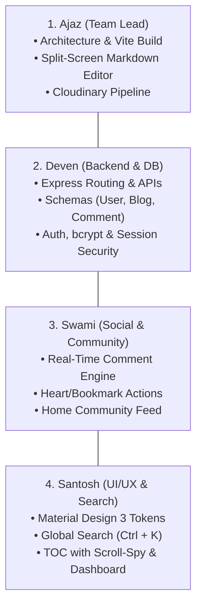

# 🎓 Inktale — Project Presentation Guide & Team Documentation

---

## 📌 Executive Summary

* **Project Name:** **Inktale** — *Modern Full-Stack Social Blogging & Publishing Platform*
* **Core Architecture:** **Hybrid Full-Stack Architecture** (Node.js/Express + EJS Server-Side Rendering combined with high-performance **React 19 Interactive Islands** compiled via **Vite**)
* **Team Members:**
  1. **Ajaz** — *Team Lead & Full-Stack / React Architect*
  2. **Deven** — *Backend & Database Engineer*
  3. **Swami** — *Social & Community Features Developer*
  4. **Santosh** — *Frontend UI/UX & Navigation Engineer*

---

## 🛠️ Complete Tech Stack & Rationale

| Layer | Technologies | Role & Purpose | Key Benefits |
| :--- | :--- | :--- | :--- |
| **Backend Runtime** | **Node.js, Express.js** | Server-side API, routing, controller logic, and EJS template orchestration. | High-throughput, non-blocking asynchronous event loop; rapid request processing. |
| **Database & Storage** | **MongoDB, Mongoose** | NoSQL document database with schemas for Users, Blogs, and Comments. | Flexible JSON-like data modeling, rapid schema iteration, and rich query operators. |
| **Session Management** | **express-session, connect-mongo** | Server-side authenticated session persistence stored in MongoDB `sessions`. | Secure HTTP-only cookies; login persistence across tab closures and server reboots. |
| **Frontend SSR** | **EJS (Embedded JavaScript)** | Server-side template rendering for all primary pages and HTML layouts. | Instant first contentful paint (FCP), lower client-side bundle size, and great SEO indexing. |
| **Interactive Islands** | **React 19, Vite** | Client-side reactive widgets mounted to targeted HTML DOM IDs. | Split-screen Markdown editor, live search modal, animated action bars, and real-time discussions. |
| **Media Pipeline** | **Cloudinary API** | Automated cloud image hosting for blog covers and user profile avatars. | Dynamic image optimization, automatic format conversion (`f_auto`), and responsive CDN delivery. |
| **Security & Utilities** | **bcrypt, compression, markdown-it, highlight.js** | Password hashing (salt rounds = 10), gzip/deflate response compression, and syntax highlighting. | Robust security posture, minimal network payload size, and syntax-highlighted code blocks. |

---

## 👥 Team Roles & Feature Matrix

### 1. Ajaz — Team Lead & Full-Stack / React Architect
* Architected the **Hybrid React Island** model using Vite library mode (`publicDir: false`) outputting directly to `public/js/dist/`.
* Engineered the **Live Split-Screen Markdown Editor** (`BlogEditor.jsx`) supporting toggleable Write, Preview, and Split views.
* Added markdown formatting toolbars (H2, H3, bold, italic, strikethrough, links, quotes, code blocks, lists).
* Built local draft auto-saving to `localStorage` and Cloudinary cover banner upload with base64 conversion.

### 2. Deven — Backend Server & Database Engineer
* Modeled Mongoose schemas: `user_model.js`, `blog_model.js`, and `comment_model.js`.
* Implemented secure authentication pipelines using **bcrypt** (10 salt rounds) and session persistence via **connect-mongo**.
* Created protected route middleware (`user_auth_middleware.js`) and REST controllers for blog creation, editing, deletion, and settings.
* Built visit counter tracking and database index optimizations.

### 3. Swami — Social & Community Features Developer
* Implemented the **Real-Time Comment & Discussion System** (`CommentSection.jsx` and `comment_controller.js`) supporting both logged-in members and guest readers.
* Developed the **Home Page Community Feed** (`CommunityFeed.jsx`), querying platform-wide discussions via `/api/community/recent`.
* Programmed optimistic UI reactions with an animated **Heart Burst pop** and private **Reading List bookmarks**.
* Built social share drawers with 1-click clipboard copy and direct links for Twitter/X, LinkedIn, and WhatsApp.

### 4. Santosh — Frontend UI/UX & Navigation Engineer
* Implemented the **Material Design 3 (MD3)** design token system (CSS variables, responsive typography, state layers, light/dark styling).
* Created the **Global Spotlight Search Modal** (`SearchModal.jsx`), triggered via top app bar button or `Ctrl + K` / `Cmd + K`, with live debounced querying.
* Developed the dynamic **Table of Contents (TOC)** with scroll-spy using `IntersectionObserver`.
* Styled the author **Dashboard & Analytics** view displaying live view counts, reactions, and published article metrics.

---

## 🎙️ Complete Presentation Speaking Script

---

### Part 1: Introduction & Architectural Vision
**Speaker:** **Ajaz** | *Estimated Time: 2 to 2.5 Minutes*

> "Respected evaluators, professors, and fellow classmates, good morning/afternoon!
>
> My name is **Ajaz**, and alongside my teammates **Deven**, **Swami**, and **Santosh**, we are excited to present our full-stack web application: **Inktale**.
>
> In today’s web landscape, modern blogging platforms face an architectural dilemma:
> * Pure **Server-Side Rendered (SSR)** apps are fast on initial load and great for SEO, but traditional page refreshes can feel clunky when engaging in live discussions or writing articles.
> * On the other hand, heavy **Single Page Applications (SPAs)** carry large JavaScript payloads and complex routing overhead.
>
> For **Inktale**, we designed a **Hybrid Island Architecture**:
> 1. The core foundation runs on **Node.js, Express.js, and EJS** for lightning-fast server rendering, clean URL routing, and search engine discoverability.
> 2. Specific high-interactivity zones run on **React 19**, compiled seamlessly via **Vite** directly into our static assets pipeline.
>
> As Team Lead and React Architect, my primary responsibility was building this bridge and engineering our **Rich Live Markdown Editor**. Traditional blog writers often have to guess how their headers, tables, code blocks, or links will look until after publishing. In Inktale, writers have:
> * A real-time split-screen view showing live-rendered markdown at 60 frames per second.
> * A formatting toolbar for headers, bold, italics, code blocks, and blockquotes.
> * An auto-save draft system backed by local storage so accidental tab closures never lose work.
> * And a cover banner zone with drag-and-drop support directly integrated with Cloudinary for image optimization.
>
> I will now pass the floor to **Deven** to discuss our backend, database design, and security."

---

### Part 2: Backend Architecture, Database & Security
**Speaker:** **Deven** | *Estimated Time: 2 Minutes*

> "Thank you, Ajaz. Hello everyone, my name is **Deven**, and I was responsible for the **Backend Architecture, Database Design, and Security** of Inktale.
>
> Our backend runs on **Node.js and Express.js**, communicating with a **MongoDB** database through **Mongoose**.
>
> Our data architecture revolves around three core schemas:
> 1. **User Model:** Stores credentials, display names, unique usernames, bios, Cloudinary profile image IDs, authored articles, and reading list references.
> 2. **Blog Model:** Stores article titles, markdown content, banner image URLs, reading time calculations, visit counts, and reaction tallies.
> 3. **Comment Model:** Connects discussions to specific blogs and user records, capturing chronological timestamps and supporting both registered members and guest contributors.
>
> For security and authentication:
> * We use **bcrypt** with a salt factor of 10 to hash all user passwords before saving to the database.
> * We implemented server-managed sessions using **express-session** backed by **connect-mongo**. Instead of fragile tokens stored in localStorage, session IDs are passed in secure, cryptographically signed HTTP-only cookies.
> * Our custom authorization middleware (`user_auth_middleware.js`) guards private actions such as blog creation, editing, deleting, and account settings, while keeping public reading routes open.
>
> Now, **Swami** will walk you through our interactive social features."

---

### Part 3: Social Interactions, Comments & Community Feed
**Speaker:** **Swami** | *Estimated Time: 2 Minutes*

> "Thank you, Deven. Hello everyone, my name is **Swami**, and I developed the **Social and Community Engagement Features** of Inktale.
>
> A great social blog must foster real conversations between writers and readers. I engineered three major systems:
> 1. **Real-Time Comment & Discussion System:**
>    * Located directly below every article, our React comment component allows readers to engage immediately.
>    * Logged-in members post under their real profiles with verified avatars, while casual visitors can post using their name without login friction.
>    * Comment submissions update the UI and database instantly, displaying relative timestamps like *'Just now'* or *'5m ago'*, and authors can delete their own comments with one click.
> 2. **Optimistic Reactions & Reading Lists:**
>    * When readers click the heart icon, an animated heart burst plays immediately, and the counter increments optimistically on screen while the background API syncs with MongoDB.
>    * Readers can save any story to their private **Reading List** for later offline reading.
> 3. **Home Page Community Feed:**
>    * To tie the platform together, we created the **Community Discussions section** on the Home Page (`/`). Calling our `/api/community/recent` endpoint, it pulls recent discussions across all articles, showing who commented, what they said, and providing a direct link back to that story.
>
> I'll now hand over to **Santosh** to showcase our UI/UX design, search, and dashboard."

---

### Part 4: UI/UX Design, Global Search & Analytics
**Speaker:** **Santosh** | *Estimated Time: 2 Minutes*

> "Thank you, Swami. Hello everyone, my name is **Santosh**, and I led the **UI/UX Design, Global Instant Search, and Author Analytics**.
>
> 1. **Material Design 3 (MD3) Design System:**
>    * We styled Inktale using unified MD3 design tokens, ensuring fluid typography (`Inter` and `Roboto Mono`), accessible contrast ratios, rounded surface containers, and smooth state-layer animations.
> 2. **Global Instant Search (`Ctrl + K`):**
>    * We implemented a spotlight search modal accessible from the top navigation bar or via the `Ctrl + K` / `Cmd + K` shortcut.
>    * It performs debounced queries against `/api/search`, displaying live matching article cards with thumbnails alongside matching author profiles in real time.
> 3. **Dynamic Table of Contents (TOC):**
>    * Long technical blogs require effortless navigation. Our React TOC automatically parses all `H2` and `H3` headers, monitors reader position using an `IntersectionObserver` scroll-spy, and provides smooth 1-click section scrolling.
> 4. **Author Analytics Dashboard:**
>    * Authors have a personalized dashboard displaying total article views, total reactions received, and total articles published, alongside quick action buttons to edit or delete their stories.
>
> I will now hand back to **Ajaz** for the live demonstration and wrap-up."

---

### Part 5: Live Demonstration Flow & Wrap-Up
**Speaker:** **Ajaz** | *Estimated Time: 1.5 to 2 Minutes*

*(Ajaz shares screen and presents live walkthrough)*:

1. **Step 1 — Home Page:**
   * *"Here is our landing page: clean blog cards, pagination, and scrolling down reveals our live **Community Discussions feed**."*
2. **Step 2 — Instant Search (`Ctrl + K`):**
   * *"Pressing `Ctrl + K` opens our search palette. As I type 'Node' or 'React', results appear instantly with banner thumbnails and author profiles."*
3. **Step 3 — Blog Detail & Table of Contents:**
   * *"Opening an article displays the banner, author info, and our dynamic **Table of Contents** that tracks reading progress."*
4. **Step 4 — Reactions & Comments:**
   * *"Notice the floating action bar: clicking Like triggers an immediate heart burst animation. Below the article, anyone can type a comment, click 'Post Comment', and see it appear instantly in the discussion thread."*
5. **Step 5 — Split-Screen Markdown Editor:**
   * *"On `/createblog`, our split-screen editor lets us format text with live preview, word counts, and Cloudinary banner uploads."*

> "In conclusion, **Inktale** proves that you do not need to choose between the speed and SEO of Server-Side Rendering and the rich interactivity of React. By unifying Express, MongoDB, EJS, and React Islands, we’ve created a fast, engaging, and modern blogging platform.
>
> Thank you, and we look forward to your questions!"

---

## ❓ Frequently Asked Evaluator Questions & Winning Answers

### Q1: "Why did you use React inside EJS instead of a pure React Single Page App (SPA)?"
* **Answer:** *"Using React as an Island Architecture gave us the ideal balance. EJS handles the page skeleton, routing, and initial server rendering, giving us instant page loads, lower bundle size, and native SEO indexing. React is applied strictly where complex state management is needed — such as the split-screen markdown editor, live search, and real-time discussion feeds — without the overhead of rewriting the backend auth and routing."*

### Q2: "How does the live markdown editor render in real time without lagging the browser?"
* **Answer:** *"The editor uses a client-side parsing pipeline inside the React component that tokenizes markdown syntax into HTML at 60fps. Because the live preview runs purely on the client's thread, zero network requests are made during typing, ensuring zero input lag."*

### Q3: "How is user authentication secured across the application?"
* **Answer:** *"We use `express-session` backed by `connect-mongo`. Passwords are encrypted with bcrypt (10 salt rounds). When a user logs in, a cryptographically signed cookie is stored on the client, while session data lives in MongoDB. Sensitive endpoints are protected by server-side middleware that validates active sessions before executing controller logic."*

### Q4: "How does the Community Feed stay synced with blog comments?"
* **Answer:** *"Whenever a reader posts a comment on any blog post, the record is stored in our MongoDB `Comment` collection. The Home Page's `CommunityFeed` component calls `/api/community/recent`, which queries the newest comments with populated user and blog fields, dynamically updating the community section across the platform."*
