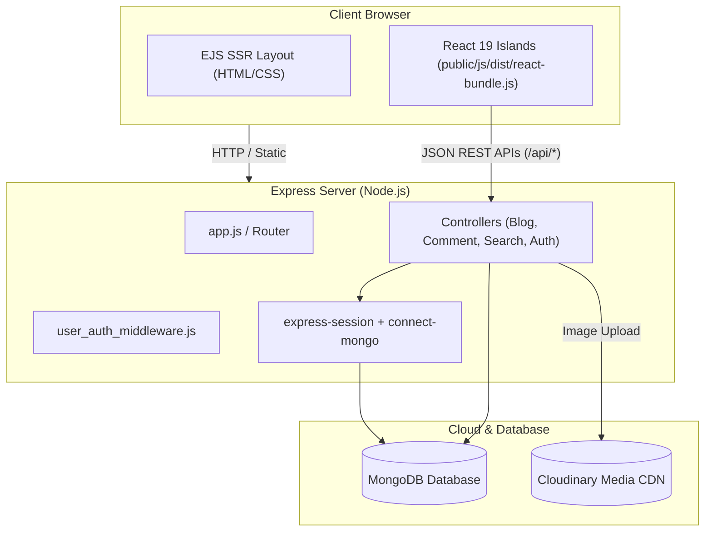

<div align="center">

  <h1>📖 Inktale</h1>
  <p><strong>A Modern Full-Stack Social Blogging & Publishing Platform with React-Powered Islands</strong></p>

  <p>
    
    
    
    
    
    
    
  </p>

  <p>
    <em>Articles at your fingertips — write with live markdown preview, engage in community discussions, and explore stories seamlessly.</em>
  </p>

</div>

---

## 🌟 Overview

**Inktale** is an enterprise-grade, modern social blogging platform engineered with a **Hybrid Full-Stack Architecture**. 

Instead of choosing between traditional Server-Side Rendering (SSR) and heavy Single Page Applications (SPA), Inktale leverages the strengths of both:
* **Node.js, Express, and EJS** power server-side rendering for instant page loads, fast First Contentful Paint (FCP), and optimal SEO.
* **React 19 Islands** (bundled via **Vite**) bring reactive state management to complex interactive widgets — including a live split-screen Markdown editor, real-time comment systems, global instant search, and optimistic animated reaction bars.

---

## 🚀 Key Features

### ✍️ 1. Live Split-Screen Markdown Editor
* **Real-Time Preview:** Toggle between *Write*, *Preview*, and side-by-side *Split View* with instant 60fps markdown rendering.
* **Formatting Toolbar:** 1-click syntax insertion for Headings (`H2`, `H3`), **Bold**, *Italics*, ~~Strikethrough~~, Links, Quotes, Inline Code, Code Blocks, and Lists.
* **Draft Auto-Recovery:** Changes auto-save to `localStorage` every few seconds to prevent accidental work loss.
* **Reading Metrics:** Real-time word counter and estimated reading time calculation.
* **Cloudinary Banner Dropzone:** Drag-and-drop cover image uploader with preview and aspect ratio guide.

### 💬 2. Real-Time Comment & Discussion System
* **Open Participation:** Supports both authenticated users (with profile avatars) and guest readers (with customizable display names).
* **Live Updates:** Comments submit asynchronously via REST API without full page reloads.
* **Author Moderation:** Authors can delete their own comments with instant optimistic UI removal.
* **Relative Timestamps:** Human-readable timestamps (*"Just now"*, *"5m ago"*, *"2h ago"*).

### 🌐 3. Home Page Community Feed
* **Live Platform Activity:** Aggregates recent reader thoughts across all blogs via `/api/community/recent`.
* **Direct Story Anchors:** Click any community quote to jump directly into that article's discussion section.
* **Instant Refresh:** Dedicated refresh trigger to pull newly added discussions on demand.

### 🔍 4. Global Spotlight Search (`Ctrl + K`)
* **Instant Discovery:** Open via navbar search icon or global keyboard shortcut (`Ctrl + K` / `Cmd + K`).
* **Debounced Search:** Queries `/api/search` in real time with thumbnail previews for blogs and author profiles.

### ❤️ 5. Animated Reactions & Reading List
* **Optimistic UI:** Like counter increments instantly on screen with an animated **Heart Pop** burst.
* **Reading List:** Bookmark articles to your private reading list for later.
* **Social Share Modal:** 1-click clipboard link copy with visual feedback, plus direct shares to Twitter/X, LinkedIn, and WhatsApp.

### 📑 6. Dynamic Table of Contents (TOC)
* **Scroll-Spy Navigation:** Automatically scans article headers (`h2`, `h3`) and highlights the section currently in view using an `IntersectionObserver`.
* **Smooth Scrolling:** 1-click jump to any section.

### 📊 7. Author Dashboard & Analytics
* **Performance Metrics:** Real-time stats on Total Visits, Total Reactions, and Total Published Articles.
* **Content Management:** Centralized hub to update or delete authored posts.

---

## 🏛️ Architecture & Tech Stack



| Layer | Technology | Purpose |
| :--- | :--- | :--- |
| **Backend** | Node.js, Express.js | Application runtime, REST endpoints, and EJS template orchestration |
| **Database** | MongoDB, Mongoose | NoSQL database for Users, Blogs, and Comments |
| **Sessions** | express-session, connect-mongo | MongoDB-backed server session management with secure cookies |
| **Frontend SSR** | EJS (Embedded JavaScript) | Server-rendered page templates, layouts, and SEO tags |
| **Frontend Reactive** | React 19, Vite | Stateful interactive islands compiled into `public/js/dist/` |
| **Media Storage** | Cloudinary | Cloud-based media storage, dynamic compression, and transformations |
| **Security** | bcrypt, compression | Password hashing (salt rounds = 10) and Gzip/Brotli payload compression |
| **Styling** | Material Design 3 (CSS3) | Design tokens, CSS custom properties, and responsive typography |

---

## 📁 Project Directory Structure

```
inktale/
├── public/                       # Static public assets (served by Express)
│   ├── css/
│   │   └── style.css             # Material Design 3 global styles
│   ├── images/                   # Icons, logos, and default avatars
│   └── js/
│       ├── dist/                 # Vite-compiled React bundles
│       │   ├── react-bundle.js   # Compiled React 19 Island bundle
│       │   └── react-bundle.css  # Island styling
│       └── *.js                  # Client scripts (theme, visits, snackbars)
│
├── react-src/                    # React 19 Component Source Code
│   ├── components/
│   │   ├── BlogEditor.jsx        # Split-screen live Markdown editor
│   │   ├── CommentSection.jsx    # Real-time discussion & comment system
│   │   ├── CommunityFeed.jsx     # Home page community discussions feed
│   │   ├── SearchModal.jsx       # Global Ctrl+K spotlight search modal
│   │   ├── BlogActionBar.jsx     # Heart reactions, bookmarks, and share
│   │   └── TableOfContents.jsx   # TOC with scroll-spy observer
│   ├── styles/
│   │   └── islands.css           # Component styles matching MD3 tokens
│   ├── utils/
│   │   └── markdownParser.js     # Client-side 60fps markdown tokenizer
│   └── main.jsx                  # React island DOM mounting engine
│
├── src/                          # Express Backend Source Code
│   ├── config/                   # Cloudinary, Mongoose, and Markdown configs
│   ├── controllers/              # Business logic & route handlers
│   ├── middlewares/              # Authentication & route guards
│   ├── models/                   # Mongoose schemas (User, Blog, Comment)
│   ├── routes/                   # Route definitions (blogs, auth, community, search)
│   └── utils/                    # Pagination, username generator, reading time
│
├── views/                        # EJS Server Templates
│   ├── layouts/                  # head.ejs, footer.ejs
│   ├── pages/                    # home, blog_detail, create_blog, dashboard, etc.
│   └── partials/                 # top_app_bar, card, pagination
│
├── .env                          # Environment variables (private)
├── app.js                        # Express server entry point
├── package.json                  # Dependencies & npm scripts
├── vite.config.mjs               # Vite library-mode bundler config
└── PRESENTATION_GUIDE.md         # Team presentation script & defense sheet
```

---

## ⚡ Getting Started

### Prerequisites
Make sure you have installed:
* [Node.js](https://nodejs.org/) (version 18.0.0 or higher)
* [MongoDB](https://www.mongodb.com/) (local instance or [MongoDB Atlas](https://www.mongodb.com/cloud/atlas) cluster)
* [Cloudinary Account](https://cloudinary.com/) (free tier works great)

---

### Installation Steps

1. **Clone or extract the repository:**
   ```bash
   git clone https://github.com/your-username/inktale.git
   cd inktale
   ```

2. **Install dependencies:**
   ```bash
   npm install
   ```

3. **Configure Environment Variables:**
   Create a `.env` file in the root directory and configure the following keys:
   ```env
   # Server Configuration
   PORT=3000

   # MongoDB Connection
   MONGO_CONNECTION_URI=mongodb+srv://<username>:<password>@cluster0.mongodb.net/inktale?retryWrites=true&w=majority

   # Session Management
   SESSION_SECRET=your_super_secret_session_key_here
   SESSION_MAX_AGE=604800000

   # Cloudinary Media Configuration
   CLOUDINARY_CLOUD_NAME=your_cloud_name
   CLOUDINARY_API_KEY=your_cloudinary_api_key
   CLOUDINARY_API_SECRET=your_cloudinary_api_secret
   ```

4. **Compile the React bundle:**
   ```bash
   npm run build:react
   ```

5. **Start the development server:**
   ```bash
   npm run dev
   ```

6. **Open in browser:**
   Navigate to [http://localhost:3000](http://localhost:3000).

---

## 📜 Available NPM Scripts

| Command | Action |
| :--- | :--- |
| `npm run dev` | Starts the Express server using `nodemon` for auto-reloading |
| `npm start` | Starts the Express server in production mode with standard `node app.js` |
| `npm run build:react` | Compiles the React components via Vite into `public/js/dist/react-bundle.js` |
| `npm run watch:react` | Runs Vite in watch mode to recompile React components instantly on save |

---

## 👥 Development Team

| Name | Role | Primary Contributions |
| :--- | :--- | :--- |
| **Ajaz** | *Team Lead & React Architect* | Architecture, React Islands setup, Live Markdown Editor, Cloudinary integration |
| **Deven** | *Backend & Database Engineer* | Express APIs, Mongoose models, bcrypt auth, session security & middleware |
| **Swami** | *Social Features Engineer* | Real-time comments, heart reactions, reading lists, Home community feed |
| **Santosh** | *UI/UX & Navigation Engineer* | Material Design 3 tokens, Global Search (`Ctrl+K`), Table of Contents, Dashboard |

---

## 📄 License

This project is licensed under the **Apache-2.0 License** — see the [LICENSE](LICENSE) file for details.
